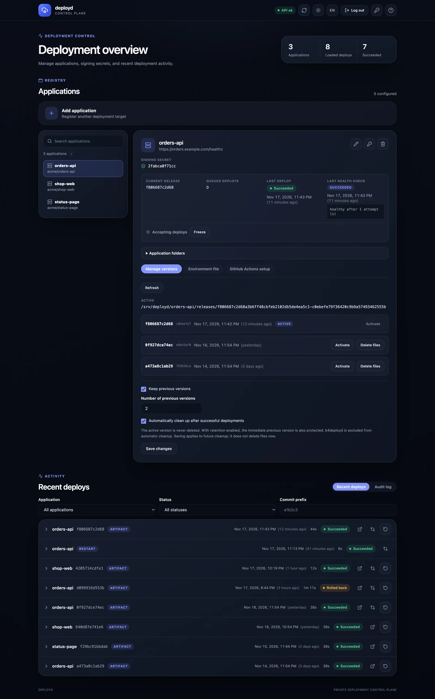

# deployd

[](https://github.com/dn2182/deployd/actions/workflows/ci.yml)
[](LICENSE)

*Léelo en [español](README-ES.md).*

**deployd puts new versions of your websites and apps onto your own servers,
automatically and safely, without giving anyone remote access to them.**

A developer pushes code to GitHub. GitHub builds it and tells deployd that a
new version is ready. deployd, a small program running on your server, fetches
that version, checks it is exactly what was built, switches the live app over
in an instant and confirms it is healthy. If the new version does not come up
healthy, deployd puts the previous one back by itself.

What that gives you:

- **No remote logins to deploy.** GitHub never gets SSH or FTP access. The
  server collects the new version itself.
- **Nothing to build on the server.** No compilers, no Docker, no extra tools
  in production.
- **Safe by default.** Every version is verified before it runs, the switch is
  instant, and a failed release rolls back on its own.
- **One web page to run it.** Add apps, watch deployments, go back to an
  earlier version, pause deployments, edit an app's settings file.
- **Simple to host.** One command installs it on an Ubuntu server. It needs no
  database server and no other services.



> **Status:** stable and in production use. deployd ships real client
> applications on several production servers, and every change is tested with
> a full install, update and uninstall on Ubuntu 24.04. The Windows setup is
> documented but not yet tested on a real server.

## Contents

1. [How it works](#how-it-works)
2. [Install on Ubuntu](#install-on-ubuntu)
3. [Register an application](#register-an-application)
4. [Connect GitHub Actions](#connect-github-actions)
5. [Go live: connect the website](#go-live-connect-the-website)
6. [App settings: .env files](#app-settings-env-files)
7. [Team access](#team-access)
8. [Operate](#operate)
9. [Database migrations](#database-migrations)
10. [Reference](#reference)
11. [Local development](#local-development)

## How it works

1. GitHub Actions builds the app and attaches the result to a GitHub release.
2. It sends deployd one signed request: which app, which commit, where the
   file is and its checksum.
3. deployd downloads the file, verifies the checksum and unpacks it.
4. It runs your database migration and pre-switch hook, if you set them.
5. It switches the live folder to the new version atomically and restarts
   the app.
6. It checks the app's health. On failure it restores the previous version.

```
GitHub Actions (build + publish release asset)
      |  HTTPS + HMAC (timestamp, nonce, per-app secret)
      v
deployd API ---- validate, enqueue, 202 + deploy_id
      |
      v
worker (one queue per app, apps in parallel)
      download + SHA256 -> unpack -> migrate -> before_cutover hook
      -> atomic cutover -> restart -> health (+ after_health hook)
      fail after cutover => automatic rollback
```

Design choices worth knowing:

- **Artifacts, not source.** What CI built is what runs. Deploys are pinned to
  a commit SHA, never a branch name.
- **A fixed contract.** The workflow cannot choose commands or paths; it can
  only trigger an app you registered.
- **Nothing else is managed.** deployd never writes your app's Nginx site or
  systemd unit. Those exist before the first deploy.
- **No external database.** Configuration is YAML, runtime state is SQLite.

## Install on Ubuntu

Git is the only thing you install by hand. The installer sets up the service,
Nginx, the management UI and any missing build tools (Node 24, uv, pnpm, all
checksum-verified). Run it as your normal user, not with `sudo`; it elevates
only what needs root.

```bash
sudo apt update && sudo apt install -y git
sudo install -d -m 0755 -o "$(id -un)" -g "$(id -gn)" /opt/deployd
git clone https://github.com/dn2182/deployd.git /opt/deployd
/opt/deployd/deploy/install-ubuntu.sh
```

It asks for:

| Prompt | Default | Unattended override |
|---|---|---|
| Public deployd domain | `deployd.example.com` | `DEPLOYD_INSTALL_DOMAIN` |
| Management bind address | `0.0.0.0` (LAN) | `DEPLOYD_INSTALL_ADMIN_BIND` |
| Management port | `844` | `DEPLOYD_INSTALL_ADMIN_PORT` |
| Management username | `deployd-admin` | `DEPLOYD_INSTALL_ADMIN_USER` |
| Management password | prompted | `DEPLOYD_INSTALL_ADMIN_PASSWORD` |
| Website connection, .env editor | asked, optional | `DEPLOYD_INSTALL_YES=1` enables both |

What you get:

- **Public API** at `https://<domain>` on port 443, with a self-signed
  certificate in `/etc/deployd/tls/`. Port 80 redirects. This is the address
  GitHub calls. Put Cloudflare in **Full** mode; for **Full (strict)** replace
  the certificate and key with a Cloudflare Origin CA pair at the same paths.
  The installer never overwrites a certificate it did not generate.
- **Management UI** at `https://<server>:844`, using the same certificate (the
  browser asks you to accept it once). Plain `http://` on that port redirects
  to `https://`. Keep the port off the internet with your firewall, or bind it
  to `127.0.0.1` and use an SSH tunnel.
- **Administrator sign-in**: choose Administrator on the sign-in screen and
  enter the admin token. The browser then asks once for the management
  username and password. Read the token with:

  ```bash
  sudo grep DEPLOYD_ADMIN_TOKEN /opt/deployd/.env
  ```

- A `deployd` system user that runs the service and owns its state
  (`/var/lib/deployd`) and the releases (`/srv/deployd`).

### Update

```bash
/opt/deployd/deploy/update-ubuntu.sh
```

It pulls the latest version, runs the tests and builds the UI before touching
the running service, waits for any deploy in progress, backs up the state
database (newest five kept in `/var/lib/deployd/backups/`) and restarts. All
settings are kept. Optional features you have not enabled are offered again.
Local edits to tracked files in `/opt/deployd` are listed and discarded; your
configuration lives outside them.

To change the domain, bind address or port, run
`/opt/deployd/deploy/install-ubuntu.sh --reconfigure`.

### Uninstall

```bash
/opt/deployd/deploy/uninstall-ubuntu.sh
```

It offers a backup, asks whether connected websites go back to real folders or
keep their links, and removes the service, its Nginx site, credentials and
state. Your deployed apps and their releases stay. Add `--purge` to also
remove the releases, recovery data, certificate and build tools.

### Change the management password

Use the key icon in the top bar of the UI. The admin token and app secrets are
not affected, and the browser asks you to sign in again.

## Register an application

Open the management UI, enter the admin token and press **Add application**.
The **Help** button in the top bar answers common questions in English and
Spanish.

| Field | Notes |
|---|---|
| Name | lowercase letters, digits, dashes; becomes `/srv/deployd/<name>/` |
| GitHub repository | `OWNER/REPO`; only release files from it are accepted |
| Public deployd URL | `https://<domain>`, used by the generated workflow |
| Kind | **Static site** (checks `index.html` exists) or **Service** (runs your restart command) |
| Local site path | static sites only: the folder Nginx already serves |
| Restart command | program and arguments, no shell; usually `sudo systemctl restart <unit>` |
| Health URL | optional; a failed check after the switch rolls back |
| Expected body / header | optional; `{commit_sha}` proves the new version is the one answering |
| Hooks | `before_cutover` (in the new version's folder) and `after_health` (failure rolls back) |
| Environment passthrough | service variables your commands may see, for example a database DSN |
| Environment file path | optional; see [App settings](#app-settings-env-files) |
| Retention | earlier versions kept for rollback (default 1) |
| Signing secret | generated and shown once; it goes to GitHub as `DEPLOYD_SECRET_<APP>` |
| GitHub access token | only for private repositories; `Contents: read` on that repository |

deployd does not create these, so have them ready on the server:

- **For a service:** its systemd unit, and permission for deployd to restart it:

  ```
  deployd ALL=(root) NOPASSWD: /usr/bin/systemctl restart <unit>
  ```

- **For a site:** the Nginx site, either serving
  `/srv/deployd/<app>/releases/current` directly or an existing folder you
  will connect in [Go live](#go-live-connect-the-website).
- **The app's own settings and secrets.**

Good to know:

- A repository with a frontend and a backend is two applications, each with
  its own secret and workflow.
- Migrate, restart and hook commands run with a clean environment plus
  `DEPLOYD_APP`, `DEPLOYD_DEPLOY_ID`, `DEPLOYD_COMMIT_SHA`,
  `DEPLOYD_RELEASE_DIR`, `DEPLOYD_CURRENT` and the passthrough variables.
  deployd's own secrets never reach them.
- A script that needs root runs as `/usr/bin/sudo <script>` with a matching
  `NOPASSWD` sudoers line.
- A GitHub token saved in the app form works immediately. The server-wide
  fallback `DEPLOYD_GITHUB_TOKEN` in `/opt/deployd/.env` needs a service
  restart after a change.

## Connect GitHub Actions

On the app card open **GitHub Actions setup**:

1. Pick how the app is built (pnpm, npm, plain HTML, or your own command such
   as `dotnet publish -c Release -o dist`), the project folder and the output
   folder.
2. Pick the **trigger**: pushes to a branch, or Git tags matching a pattern
   such as `v*`. With the checkbox on, a push or tag deploys by itself. With
   it off, you start the workflow from the Actions tab.
3. Optional **Deployment targets** (`web-01, web-02`) when the same app runs
   on several servers, each with its own deployd.
4. **Preview workflow** shows it. **Save settings and download ZIP** gives you
   `.github/workflows/deployd.yml`, `scripts/notify_deploy.py` and
   `DEPLOYD-SETUP.md`. Unzip at the repository root and commit.

Then add these in the repository under Settings, Secrets and variables,
Actions:

| | One server | Deployment targets |
|---|---|---|
| Variable | `DEPLOYD_URL` | `DEPLOYD_URL_WEB_01`, `DEPLOYD_URL_WEB_02` |
| Secret | `DEPLOYD_SECRET_<APP>` (or `DEPLOYD_SECRET`) | `DEPLOYD_SECRET_WEB_01`, `DEPLOYD_SECRET_WEB_02` |

Several apps in one repository: rename the workflow file per app
(`deployd-api.yml`, `deployd-web.yml`), use different tag prefixes in tag
mode, and one secret per app. The notifier script is shared.

What the workflow does:

- **build** packages the output folder. Symlinks, `node_modules`, `.env` files
  and private keys are rejected.
- **publish** attaches the package to a release (the pushed tag, or a
  `deploy-<app>-<sha>` release it creates and prunes to the newest ten),
  notifies deployd and waits for the result.
- With targets, a **deploy** job notifies every server after one publish.
- The run fails if the deploy fails, rolls back, is cancelled or is replaced
  by a newer push. GitHub sees step names and results only; command output
  stays in the management UI.
- A manual run has a `dry_run` option that builds without deploying.
  Uncomment the `environment:` line to require an approval.

## Go live: connect the website

For a static site that Nginx already serves from a folder such as
`/var/www/example.com`:

1. Deploy once, so a current version exists.
2. On the app card open **Website connection**, press **Connect website** and
   type the app name.

The folder is swapped for a link to the current version in one step. Your
original files are kept as the `b4deployd` version, which you can activate
again at any time. Nginx configuration is not touched. If the path is later
replaced by a real folder, the tab says so and **Fix connection** links it
again without deleting anything.

Sites must sit directly under `/var/www` or a folder listed in
`/etc/deployd/site-roots` (`DEPLOYD_INSTALL_SITE_ROOTS=/srv/sites` adds one,
then rerun the update). Details and recovery:
[docs/website-connection.md](docs/website-connection.md).

If you prefer, point Nginx's `root` at `/srv/deployd/<app>/releases/current`
yourself and skip this step.

## App settings: .env files

Keep each app's `.env` outside its release folder. Deploys and rollbacks never
touch it. The recommended place is `/etc/apps-env/<app>/<app>.env`:

```bash
sudo install -d -m 0750 -o root -g <appuser> /etc/apps-env/<app>
sudo install -m 0640 -o root -g <appuser> /dev/null /etc/apps-env/<app>/<app>.env
```

Load it from the app's systemd unit with
`EnvironmentFile=/etc/apps-env/<app>/<app>.env`.

With the .env editor enabled at install time, you manage the file from the UI:

1. Edit the app and set **Environment file path**.
2. Open the **Environment file** tab and press **Open file**. Values are
   hidden until you reveal one. **Edit as text** shows the raw file.
3. **Save file**, optionally restarting the app and checking its health.

What to expect:

- The file keeps its owner and permissions.
- Each save keeps the previous version on the server (newest ten), and
  **Restore previous version** brings it back.
- The audit log records who opened or changed the file and which keys
  changed, never the values.
- A save is refused if the file changed on the server after you opened it.
- The file must already exist and be named `.env`, `.env.<name>` or
  `<name>.env`.
- Each server has its own file. With several servers, repeat the change on
  each one.

Files kept somewhere else work too. Add their folder, for example
`/etc/myapp`, as a line in `/etc/deployd/env-roots` and rerun the update
(`DEPLOYD_INSTALL_ENV_ROOTS=/etc/myapp` does it unattended). Folders under
`/home` are not reachable, and deployd's own configuration cannot be edited
this way. Security notes: [SECURITY.md](SECURITY.md).

## Team access

Share selected applications with teammates without sharing the admin token.
Open **Team access** in the top bar, add a member and switch on the
applications they should have. A password can be generated for you and is
shown once.

A member signs in on the same page with their own username and password and
sees only their applications. There they can:

- follow deployments and read their output, redeploy and cancel a queued one
- activate an earlier version and delete kept versions
- freeze and unfreeze deploys
- view and edit the `.env` file, with restore and restart
- download the GitHub Actions workflow

Only the administrator can add, edit or remove applications, change their
commands and paths, handle signing secrets and GitHub tokens, connect
websites, and manage members. That line exists because an application's
commands run on the server.

Good to know:

- Every action is recorded in the audit log under the member's name. A member
  sees only the entries about their applications.
- Turning off **Can sign in**, resetting the password or removing the member
  ends their sessions immediately. Sessions also end after 12 hours.
- Five wrong passwords lock that username for 15 minutes.
- Accounts live on each server. A teammate with applications on two servers
  needs an account on both.
- Members reach the UI the same way you do, so remote teammates need your VPN
  or tunnel.

## Operate

- **Status card** per app: current version, queue, last deploy, last health
  check, website link state.
- **Freeze** pauses deploys from GitHub for an app. Going back to an earlier
  version still works.
- **Recent deploys** shows the last ten with filters and commit search. You
  can cancel a queued deploy or redeploy one. It refreshes every minute;
  the Refresh button or the `r` key updates now.
- **Manage versions** activates an earlier version, deletes kept versions and
  sets how many to keep. Activating does not undo database migrations, so the
  older code must work with the current database.
- **Rollback** is automatic when the restart or health check fails after a
  switch.
- **Audit log** lists every management action and who did it.
- **`deployd check`** validates the configuration on the server, verifies the
  state database and warns about unlinked sites or frozen apps. Run it after
  editing files by hand.

## Database migrations

`deployd-migrate` applies `NNN_name.sql` files in order, records each file's
checksum and refuses to continue when an applied file was changed. Set it as
the app's migrate command and a failed migration stops the deploy before the
switch.

```bash
deployd-migrate --dir migrations --dialect mssql --dsn-env DEPLOYD_MIGRATE_DSN
deployd-migrate --dir migrations --dialect postgres --dsn-file /etc/app/dsn --dry-run
deployd-migrate --dir migrations status
```

Give the connection string with `--dsn-env` (and list that variable in the
app's environment passthrough) or `--dsn-file`. Each file runs in one
transaction, and two runs against the same database never overlap. Install
the driver with `pip install 'deployd[mssql]'` or `'deployd[postgres]'`.

## Reference

### Request contract

```
POST /deploys
X-Deploy-Timestamp: <unix epoch seconds>        (±5 minutes)
X-Deploy-Nonce: <uuid4>                         (single use per app)
X-Deploy-Signature: sha256=<hex hmac of "{timestamp}.{nonce}.{raw body}">

{"app": "...", "commit_sha": "<40 hex>", "artifact_url": "https://...",
 "artifact_sha256": "<64 hex>", "triggered_by": "github-actions:<run_id>"}
```

The answer is `202` with a `deploy_id`. `GET /deploys/{deploy_id}` then
reports `queued`, `running`, `succeeded`, `failed`, `rolled_back`,
`superseded` or `cancelled`, with the steps. Sending the same signed request
again returns the same id. A bad signature or unknown app answers `401`, a
frozen app `423`, a file from outside the app's repository `403`.

### Paths

| Path | Contents |
|---|---|
| `/opt/deployd` | the checkout, its tools and `.env` (admin token, service settings) |
| `/var/lib/deployd` | `apps.yaml`, `secrets.env`, the state database and its backups |
| `/srv/deployd/<app>/releases/` | `current/` plus the kept earlier versions |
| `/etc/deployd/tls/` | certificate and key for the public API and the management UI |
| `/etc/deployd/site-roots` | folders whose sites may be connected |
| `/etc/deployd/env-roots` | folders whose `.env` files may be edited |
| `/etc/apps-env/<app>/` | default home of each app's `.env` |
| `/var/lib/deployd-env` | earlier versions of edited `.env` files, root only |
| `/var/lib/deployd-connect` | website connection recovery data, root only |
| `/var/lib/deployd-auth` | management login |

### Service settings

`/opt/deployd/.env` holds `DEPLOYD_ADMIN_TOKEN`, the optional
`DEPLOYD_GITHUB_TOKEN` fallback for private repositories, and
`DEPLOYD_DRAIN_TIMEOUT_SECONDS` (how long a stop waits for a deploy that is
mid-switch, default 600). Setting `DEPLOYD_SECRET_<APP>` or
`DEPLOYD_GITHUB_TOKEN_<APP>` there overrides the UI for that app. Restart the
service after changing this file.

Everything the UI edits lives in `/var/lib/deployd/apps.yaml`.
[config/apps.example.yaml](config/apps.example.yaml) documents every key,
including size limits and timeouts. Release storage and retention:
[docs/release-layout.md](docs/release-layout.md).

### Security and Windows

The hardening checklist and security properties are in
[SECURITY.md](SECURITY.md). A Windows setup with NSSM and IIS is described in
[deploy/windows.md](deploy/windows.md); its installer has not been tested on a
real Windows server.

## Local development

Python 3.11.4+, uv, Node 24, pnpm 12.

```bash
make install                                   # Python + web dependencies
cp .env.example .env                           # set DEPLOYD_ADMIN_TOKEN and the local paths
cp config/apps.example.yaml config/apps.yaml
make dev                                       # API on 127.0.0.1:8300
make dev-web                                   # Vite UI, proxies /api to the API
make check                                     # ruff, pytest, oxlint, vitest
make check-audit                               # pip-audit and pnpm audit
```

```
src/deployd/        API, deploy worker, SQLite store, migrate and check commands
web/                management UI (React, Vite, Tailwind)
deploy/             Ubuntu installer, updater, uninstaller, systemd unit, root helpers
examples/           reference workflow and the notifier script
docs/               website connection and release layout in depth
tests/              pytest for API, worker and installer; web/ uses vitest
```

See [CONTRIBUTING.md](CONTRIBUTING.md). Apache-2.0, see [LICENSE](LICENSE) and
[NOTICE](NOTICE).
